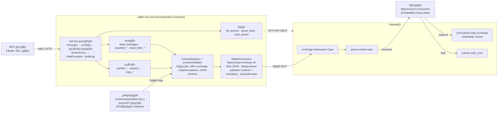
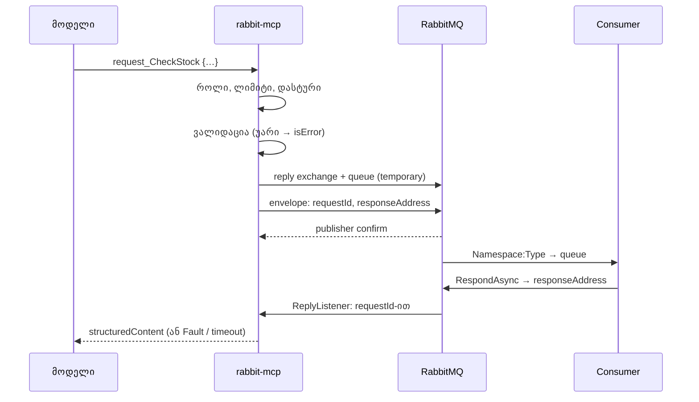
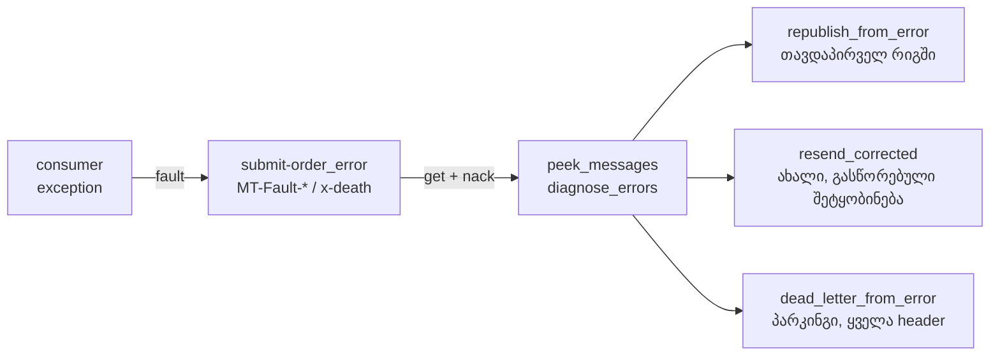

# როგორ მუშაობს rabbit-mcp

[English](architecture.md) · **ქართული**

სამი დიაგრამა კოდზე მომუშავეთათვის: კომპონენტები, `request_*` გამოძახების გზა და `_error` რიგიდან აღდგენა. წესები,
რომლებსაც ისინი ეყრდნობა, [CLAUDE.md](../CLAUDE.md)-შია.

## კომპონენტები

ყოველი გამოძახება ჯერ call-tool ფილტრებს გადის, მერე ხელსაწყო რეესტრით ამოწმებს შეტყობინებას და `RabbitConnection`-ით
აგზავნის. Management HTTP API მხოლოდ `list_queues`-ს იყენებს.

## `request_*` გზა

Raw კონტრაქტებისთვის იგივე გზაა RabbitMQ RPC-ით: `reply_to` = reply რიგი, დამთხვევა `correlation_id`-ით, პასუხის ტიპი
AMQP `type`-დან და არასდროს body-დან. `publish_*` confirm-ზე ჩერდება.

## აღდგენა `_error` რიგიდან

ყოველი გადატანა: get → confirmed publish → ack; წყარო ack-დება მხოლოდ confirm-ის შემდეგ, წაშლის ხელსაწყო არ არსებობს.
სამივე ნაგულისხმევად გამორთულია (`EnableRepublish` / `EnablePublish`) და audit-ში იწერება. Republish უარს ამბობს, თუ
`MT-Fault-InputAddress` error რიგის მფლობელს არ ემთხვევა.

