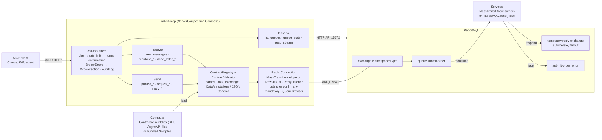
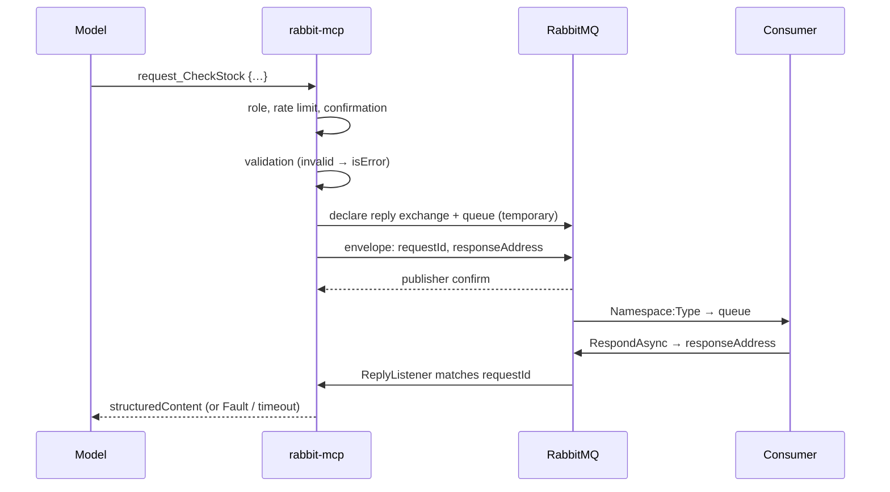
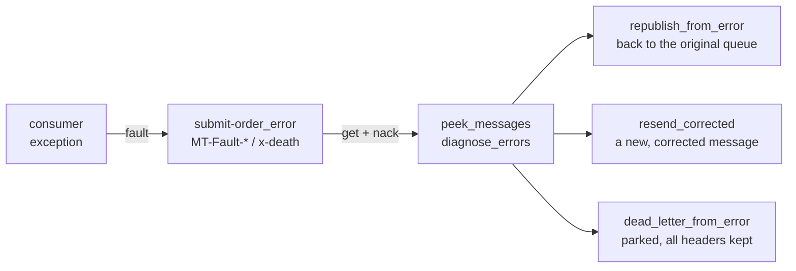

# How rabbit-mcp works

**English** · [ქართული](architecture.ka.md)

Three diagrams for people working on the code: the components, the path of a `request_*` call, and recovery from an
`_error` queue. The rules behind them are in [CLAUDE.md](../CLAUDE.md).

## Components

Every call passes the call-tool filters first, then the tool validates the message through the registry and sends it
with `RabbitConnection`. The management HTTP API is used only by `list_queues`.

## The `request_*` path

Raw contracts take the same path as RabbitMQ RPC: `reply_to` is the reply queue, matching is by `correlation_id`, and
the reply type comes from the AMQP `type`, never from the body. `publish_*` stops at the confirm.

## Recovering from an `_error` queue

Every move is get → confirmed publish → ack; the source is acked only after the confirm, and there is no delete tool.
All three are off by default (`EnableRepublish` / `EnablePublish`) and audited. Republish refuses when
`MT-Fault-InputAddress` disagrees with the error queue's owner.

